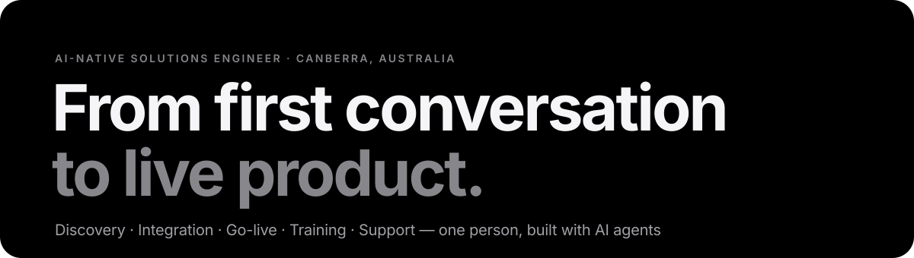
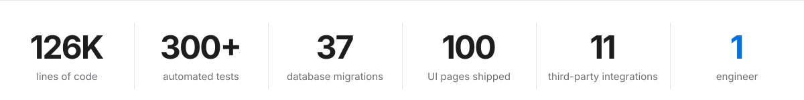

  <a href="https://how1ewang.github.io/"><b>how1ewang.github.io</b></a>
  &nbsp;&nbsp;·&nbsp;&nbsp;
  <a href="mailto:howiewang122@gmail.com">howiewang122@gmail.com</a>
  &nbsp;&nbsp;·&nbsp;&nbsp;
  <a href="https://how1ewang.github.io/Howie_Wang_Resume.pdf">Résumé (PDF)</a>

 

I sit between the people who run a business and the systems that run it: understanding the need, choosing and integrating the right tools, getting them live, and making sure the people using them succeed. For the past year I have been the single point of contact between a biotech company's owner and the platform that runs the business — eleven partner systems, 50 releases, 800+ members — from the first conversation to day-to-day support.

<picture>
  <source media="(prefers-color-scheme: dark)" srcset="assets/stats-dark.svg">
  
</picture>

## Case study

### YuanQiPai — integrated commerce platform &nbsp;2025 – present · sole technical lead

A biotech company sells health products through a dealer network and directly to consumers on WeChat. It ran on disconnected tools: no single view of members, dealers, orders or commissions, and every marketing change needed outside help.

- **Discovery & scope** — mapped how members, dealers, orders and money actually moved, then shaped that into 17 product areas with a phased plan: storefront first, loyalty and dealer tools next, content and training after.
- **Implementation & integration** — a WeChat Mini Program storefront (58 screens), a staff console (42 screens), the platform behind them, and a stand-alone registration tool; 11 partner systems integrated for payments, sign-in, ERP fulfilment, cloud media and notifications — including request signing implemented by hand where no SDK existed.
- **Go-live** — WeChat platform compliance, entity-change filing, food-seller registration paperwork, domain and HTTPS, a launch-readiness checklist, a zero-downtime data migration.
- **Training & support** — an illustrated operations guide so staff run day-to-day changes without a developer; structured feedback rounds turned into 50 releases in six months; on call when something broke.
- **Decisions that mattered** — a drag-and-drop page builder so marketing never waits for a developer; commission rules as console settings rather than code; automatic refunds for payments that arrive after cancellation.

The source is private (client code). The full case study, with the decisions and their outcomes, is on [the site →](https://how1ewang.github.io/#work)

### Selected integrations

| Partner | What it does for the business | Notable |
|---|---|---|
| WeChat Pay v3 · Alipay · AdaPay | Consumer and dealer payments; refunds through the original channel | One payment abstraction across three providers; late payments after a cancellation are refunded automatically |
| WeChat Login · Order Centre | One-tap sign-in with phone number; orders visible in WeChat's native "My Orders" | Detects new vs. existing customers and merges accounts |
| WeCom (Enterprise WeChat) | Staff single sign-on to the console; contact directory sync | OAuth callback flow |
| Hupun ERP · store platform | Paid orders pushed to ERP and store systems for fulfilment | MD5 / HMAC-SHA256 signing by hand; retryable outbound queue so a partner outage never blocks a sale |
| Alibaba Cloud SMS · OSS · MTS | Notifications, media storage with direct upload, video transcoding | HMAC-SHA1 request signing without the vendor SDK |

### Customer Registration System &nbsp;2026 · sole technical lead

Sales staff in 20 countries were collecting customer details on paper. In ten weeks that became a phone form anyone can hand to a customer (3,423-district address picker, ID photo capture, feedback survey), a map dashboard the owner can check at any time, and a signed webhook with retry that keeps the main platform consistent without duplicate records. [Details →](https://how1ewang.github.io/#registration)

## What I bring

| Area | Evidence |
|---|---|
| **Integration & implementation** | 11 partner systems integrated; environments, domains, HTTPS and CDN configured; signing schemes implemented where SDKs were missing |
| **Discovery & requirements** | An owner's goals turned into 17 scoped product areas with a phased plan |
| **Go-live & support** | Launch checklist; zero-downtime migration planned around dealers' business hours; health checks, runbooks, audit logs; first line of support |
| **Enablement & training** | Illustrated operations guide for non-technical staff; 16 operational documents; feedback rounds turned into prioritised releases |
| **Data & reporting** | Finance reconciliation and exports for the accountant; a map dashboard with four-level drill-down |
| **Compliance & platform administration** | WeChat platform requirements, entity-change filing, food-seller registration |
| **Communication** | English and Mandarin; owners, staff, accountants and vendors' engineers each got the document they needed |

## Technical foundation

Node.js · Express · PostgreSQL · SQLite · REST APIs · OAuth · Webhooks · WeChat Mini Program · HTML / CSS / JavaScript · WeChat Pay v3 · Alipay · AdaPay · Alibaba Cloud (ECS, OSS, SMS, MTS) · Docker · Nginx · DNS / TLS · GitHub Actions · Jest (300+ tests)

I built all of the above myself, so I can talk to a customer's engineers as a peer, debug an integration from the logs, and prototype when a slide isn't enough. The engineering deep-dive — architecture, testing, security, annotated code — is at [how1ewang.github.io/engineering](https://how1ewang.github.io/engineering/).

 

Open to junior solutions engineering, implementation and technical consulting roles &nbsp;·&nbsp; Canberra · Sydney · remote &nbsp;·&nbsp; English / 中文

